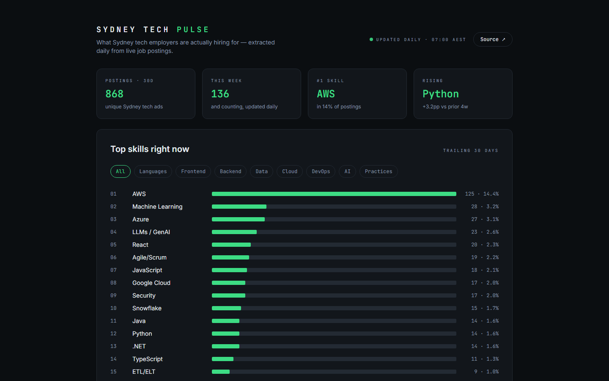

<!-- markdownlint-disable MD033 -->
<div align="center">

# 📡 Sydney Tech Pulse

**Which skills are Sydney tech employers actually hiring for? A live data pipeline that answers with numbers, not vibes — updated every morning.**

[](https://github.com/sa1701/sydney-tech-pulse/actions/workflows/ci.yml)
[](https://github.com/sa1701/sydney-tech-pulse/actions/workflows/pipeline.yml)
**[Live dashboard →](https://sydney-tech-pulse.vercel.app)**



</div>

---

## What it does

Every morning at 07:00 Sydney time, a scheduled pipeline pulls the latest tech job postings for Sydney, extracts the skills each ad asks for, and loads them into Postgres. A live dashboard turns that into:

- **Top skills right now** — ranked demand over the trailing 30 days, filterable by family (languages, cloud, AI, …)
- **Weekly demand trends** — how each skill's share of postings moves week to week
- **Salary bands by skill** — median advertised ranges, employer-stated only
- **Movers** — which skills are gaining share vs their prior 4-week average

Built because I'm a final-year AI & Big Data student job-hunting in this exact market — I wanted the answer to "what should I be learning?" to come from data.

## Architecture

```
GitHub Actions (cron, daily 07:00 AEST)            Vercel
┌───────────────────────────────────┐     ┌──────────────────────┐
│  pipeline/  (Python)              │     │  web/  (Next.js 14)  │
│  fetch → extract → upsert         │     │  ISR dashboard       │
│  Adzuna API   regex    psycopg3   │     │  recharts            │
└───────────────┬───────────────────┘     └──────────┬───────────┘
                │ writes (owner role)                │ reads (anon + RLS)
                └────────► Supabase Postgres ◄───────┘
                     tables + 5 analytics views
```

**Design decisions**
- **Raw SQL, no ORM** — the schema and analytics views (`pipeline/schema.sql`) are the product: window-style weekly aggregates, median salaries via `percentile_cont`, share-of-market movers.
- **Deterministic skill extraction** — a [~90-skill taxonomy](pipeline/src/pulse/taxonomy.py) of word-boundary regexes handles the classic traps (Go vs "go", C vs C++ vs C#, Java vs JavaScript, R as a bare letter). No LLM: reproducible, testable, free, and CI never flakes.
- **Idempotent loads** — `ON CONFLICT` upserts keyed on the Adzuna ID; re-running any window inserts zero duplicates.
- **Row-level security** — the dashboard's anon role can only read; writes require the pipeline's owner connection.
- **Zero cost** — Adzuna free tier (a daily run is ~10 calls of the 250/day budget), Supabase free tier, Vercel hobby, public-repo Actions minutes.

## Testing & CI

- Unit tests pin the extractor's edge cases (`pipeline/tests/test_extract.py`) — the Java/JavaScript and Go/"go" traps are regression-tested forever.
- Integration tests run against a **real Postgres service container in GitHub Actions**: schema application, upsert idempotency, and all five views (`test_db.py`).
- `docker compose up db` gives an identical local Postgres so dev never touches production.

## Running it yourself

```bash
# secrets: ADZUNA_APP_ID, ADZUNA_APP_KEY (free at developer.adzuna.com), DATABASE_URL
docker compose up -d db                       # local Postgres on :5433
cd pipeline && pip install -r requirements.txt
python -m pulse.run --backfill                # one-time 30-day backfill
python -m pulse.run                           # daily incremental (the cron does this)
pytest                                        # 15 tests, DB tests need DATABASE_URL
```

Dashboard: `cd web && npm i && npm run dev` with `NEXT_PUBLIC_SUPABASE_URL` + `NEXT_PUBLIC_SUPABASE_ANON_KEY` in `.env.local`.

## Honest limitations

- Adzuna truncates ad descriptions, so skills mentioned late in an ad are undercounted — uniformly across all postings, so *rankings* stay meaningful.
- Adzuna's coverage is not the entire Sydney market (it's an aggregator sample).
- Salary medians use employer-stated figures only (Adzuna's ML-predicted salaries are excluded) and small samples are suppressed.
- History accumulates from July 2026 onward; the backfill seeded the first 30 days.
